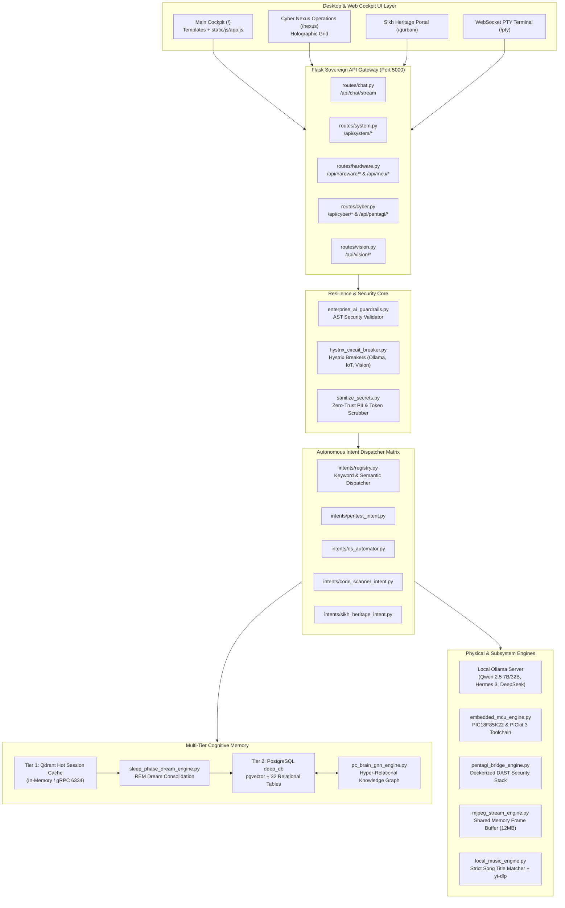

# 🏛️ D.E.E.P. Sovereign Cockpit — System Architecture Specification

> **Dynamic Executive Edge Platform (D.E.E.P.)**  
> *Authoritative Engineering Architecture, Data Flow, and API Reference*

---

## 1. Executive Architectural Philosophy

D.E.E.P. is designed from first principles as an **offline-first, zero-cloud sovereign cognitive architecture**. It unifies local Large Language Model (LLM) orchestration, zero-trust AST execution guardrails, physical hardware/embedded MCU flashing, and real-time multi-modal computer vision into a resilient executive cockpit.

### Core Architectural Axioms
1. **Zero-Trust Pre-Flight Sanitization**: Inbound inputs and outbound logging are scrubbed for credentials, API tokens, and PII before hitting logs or vector embeddings.
2. **AST-Enforced Read-Only Guardrails**: Machine-generated SQL queries pass through an Abstract Syntax Tree (AST) validator. Destructive DDL/DML mutations (`DROP`, `DELETE`, `TRUNCATE`, `ALTER`) are blocked deterministically; non-mutating reads are clamped to `LIMIT 100`.
3. **Resilience via Hystrix Circuit Breakers**: Flaky or hanging peripheral services (IoT endpoints, slow vision inference, external APIs) are wrapped in stateful circuit breakers that trip to `OPEN` within $\le 1.5\text{s}$, preventing UI deadlocks.
4. **Deterministic Multi-Tier Memory**: Volatile interactions land in an ultra-low-latency in-memory/Qdrant hot cache (Tier 1) and are consolidated nightly into PostgreSQL `deep_db` vectors and knowledge graphs via an asynchronous REM machine dreaming cycle (Tier 2).

---

## 2. System Architecture & Topology



---

## 3. The 10 Core Architectural Pillars

### Pillar 1: Dual Co-Pilot Matrix (J.A.R.V.I.S. & F.R.I.D.A.Y.)
- **Routing**: Handled by `model_router.py` and `llm_harness/dual_core_engine.py`.
- **System 1 (Reflex / Intuition)**: Rapid small-parameter models (e.g., `qwen2.5:3b`, `hermes3:8b`) delivering verbal responses in under 500ms.
- **System 2 (Deliberative / Reasoning)**: Deep analytical models (e.g., `deepseek-r1:8b`, `qwen2.5-coder:32b`) handling complex code refactoring, AST audits, and recursive code generation.

### Pillar 2: Dual-Tier Cognitive Memory & Machine Dreaming
- **Tier 1 (Hot Session Cache)**: Backed by `qdrant_session_cache.py`. Uses sub-millisecond in-memory vector storage for active conversational context without disk write overhead.
- **Tier 2 (Cold Deep Memory)**: Backed by PostgreSQL `deep_db` with `pgvector`. Stores permanent entities, observations, and facts.
- **Machine Dreaming Consolidation**: `sleep_phase_dream_engine.py` runs during idle or nightly maintenance. It synthesizes volatile session turns into clean facts, extracts DPO fine-tuning pairs into `dataset_fine_tune.jsonl`, and flushes Tier 1 hot cache.

### Pillar 3: Hystrix Circuit Breakers
- **Engine**: `hystrix_circuit_breaker.py`.
- **States**: `CLOSED` (Healthy), `OPEN` (Tripped/Short-Circuited), and `HALF-OPEN` (Probing Recovery).
- **Monitored Services**:
  - `ollama_inference`: Failure threshold 3, recovery timeout 12.0s.
  - `iot_smart_home`: Failure threshold 2, recovery timeout 8.0s.
  - `vision_hardware`: Failure threshold 2, recovery timeout 5.0s.
- **SLA**: Enforces strict timeout boundaries ($\le 1500\text{ms}$) to guarantee UI latency $\le 50\text{ms}$.

### Pillar 4: Zero-Trust Security & AST Guardrails
- **Pre-Flight Sanitization**: `sanitize_secrets.py` masks secrets via high-entropy regex and token matching.
- **AST Query Protection**: `enterprise_ai_guardrails.py` parses SQL statements with `ast` or SQLglot. Any DDL/DML mutation is immediately blocked with `SECURITY_VIOLATION`.

### Pillar 5: Hardware Vitals & RTX GPU Telemetry
- **Hardware Profile**: NVIDIA RTX A2000 8GB Laptop GPU (CUDA 12.x), Intel multi-core CPU.
- **Telemetry Endpoints**: `/api/hardware/status` and `/api/system/metrics` stream live GPU temperatures, VRAM allocations, CPU load, and RAM usage.

### Pillar 6: Zero-Copy Multi-Modal Vision
- **Buffer**: `shared_memory_frame_buffer.py` manages a 12.44 MB POSIX-compatible shared memory ring buffer (`deep_mjpeg_frame_buffer`) avoiding inter-process serialization overhead.
- **Computer Vision**: OpenCV + MediaPipe for hand and face tracking, screen region watchers, and optical hardware component inspection.

### Pillar 7: Embedded Microcontroller Toolchain (PIC18F85K22)
- **Target Microcontroller**: Microchip PIC18F85K22 (80-pin TQFP, 4.9152 MHz external crystal).
- **Programmer**: Microchip PICkit 3 (`BUR181916585`).
- **Compiler**: Microchip XC8 v3.10 (`xc8-cc.exe`).
- **Headless Flashing**: Automated via `ipecmd.exe` with USB Mutex locking.
- **Mandatory LCD Hardware Defect Guard**: Line 1 of the board's 16x2 LCD is broken/unreadable. The toolchain enforces strict rendering solely on **Line 2** (`LCD_Set_Cursor(2, 1)`, addresses `0xC0..0xCF`).

### Pillar 8: Autonomous PentAGI Security Testing
- **Engine**: `pentagi_bridge_engine.py` and `intents/pentest_intent.py`.
- **Zero-Trust Scope Validation**: Scans are strictly restricted to local IP ranges (`127.0.0.0/8`, `10.0.0.0/8`, `172.16.0.0/12`, `192.168.0.0/16`, `localhost`, `host.docker.internal`). Public/external internet targets are blocked unconditionally.

### Pillar 9: Local Music & Audio Playback Directives
- **Engine**: `local_music_engine.py`.
- **Strict Matching**: Song title matching against local library (`C:\Users\User\Music`). Never plays an unrelated song simply because the artist matches.
- **Autonomous Download Fallback**: Missing tracks are autonomously fetched via `yt-dlp` to the local music folder.
- **Exclusivity**: Native Google Chrome launch via `os.startfile()` only when YouTube is explicitly requested.

### Pillar 10: Sovereign Sikh Heritage & Gurbani Multimodal Gateway
- **Engine**: `intents/sikh_heritage_intent.py` and `routes/gurbani.py`.
- **Capabilities**: Full Nitnem banis, Gurmukhi text rendering with Phonetic Romanization and English translations, and Hukamnama introspection.

---

## 4. REST & WebSocket API Specification

| Method | Endpoint | Description | Response Status |
| :--- | :--- | :--- | :--- |
| `GET` | `/` | Main Sovereign AI Cockpit Interface | `200 HTML` |
| `GET` | `/nexus` | Holographic Cyber Nexus Operations Center | `200 HTML` |
| `GET` | `/gurbani` | Sikh Heritage & Gurbani Gateway | `200 HTML` |
| `POST` | `/api/chat` | Synchronous Multi-Turn Dual Co-Pilot Chat | `200 JSON` |
| `POST` | `/api/chat/stream` | Real-time Token & Execution Streaming | `200 SSE` |
| `GET` | `/api/history` | List Recent Chat Sessions | `200 JSON` |
| `GET` | `/api/chats/<id>` | Retrieve Full Message History for a Session | `200 JSON` |
| `DELETE` | `/api/chats/<id>` | Delete a Conversation Session | `200 JSON` |
| `GET` | `/api/system/info` | Host Vitals, OS Version, and Uptime | `200 JSON` |
| `GET` | `/api/system/version` | Active Build Hash & Boot Timestamp | `200 JSON` |
| `GET` | `/api/system/circuit_breakers` | Resilience Matrix & Breaker Health Ratios | `200 JSON` |
| `POST` | `/api/system/circuit_breakers/reset` | Manually Reset All Circuit Breakers to CLOSED | `200 JSON` |
| `GET` | `/api/hardware/status` | Real-Time CPU, RAM, and GPU VRAM Metrics | `200 JSON` |
| `GET` | `/api/hardware/mcu/status` | PIC18F85K22 Toolchain & Project Inventory | `200 JSON` |
| `GET` | `/api/mcu/status` | Alias for MCU Toolchain Status | `200 JSON` |
| `POST` | `/api/hardware/mcu/compile` | Compile MPLAB X Project C Firmware via XC8 | `200 JSON` |
| `POST` | `/api/hardware/mcu/flash` | Flash Hex File via PICkit 3 (`ipecmd.exe`) | `200 JSON` |
| `GET` | `/api/cyber/devices` | Local Network Device Scan & MAC/OUI Inventory | `200 JSON` |
| `GET` | `/api/cyber/pentagi/status` | PentAGI Docker Container State Inspection | `200 JSON` |
| `POST` | `/api/cyber/pentagi/start` | Spin Up PentAGI Docker Stack | `200 JSON` |
| `POST` | `/api/cyber/pentagi/stop` | Tear Down PentAGI Docker Stack | `200 JSON` |
| `GET` | `/api/vision/mjpeg_feed` | Low-Latency MJPEG Video Stream (Hardware Inspection)| `200 Stream` |
| `WS` | `/pty` | Interactive Raw PTY Terminal WebSocket | `101 Protocol` |

---

## 5. PostgreSQL Database Schema (`deep_db`)

The primary persistence engine is PostgreSQL 16+ on port `5432` with the `vector` extension enabled.

| Table Name | Description | Key Columns |
| :--- | :--- | :--- |
| `chat_sessions` | High-level conversation threads | `id`, `title`, `created_at`, `updated_at` |
| `chat_messages` | Full conversational log | `id`, `chat_id`, `role`, `content`, `timestamp` |
| `facts` | Distilled semantic knowledge & rules | `id`, `concept`, `facts`, `timestamp` |
| `mem0_episodic_vectors` | pgvector episodic embeddings (1536-dim) | `id`, `vector`, `document`, `metadata` |
| `knowledge_graph_entities` | Semantic Knowledge Graph nodes | `id`, `name`, `entity_type`, `properties` |
| `knowledge_graph_relations` | Semantic Knowledge Graph edges | `id`, `source_id`, `target_id`, `relation_type` |
| `flight_readiness_audits` | Autonomous audit & benchmark logs | `id`, `audit_timestamp`, `readiness_score`, `ollama_latency_ms` |
| `security_settings` | Zero-trust authentication & firewall rules | `key`, `value`, `updated_at` |

---

## 6. Verification & Health Audit Runbook

To execute the authoritative 10-pillar automated diagnostic suite:

```bash
# Full 10-Pillar Cockpit Audit
python check_deep.py

# Unit & Intent Test Suites
python test_user_intents_and_skills.py
python test_pillars_1_and_2.py
python test_phase3_phase4.py
python test_circuit_ui_and_embedded_mcu.py
python test_hystrix_and_infer_scanner.py
python test_pentagi_integration.py
```
